# ESP32 Wi-Fi Home Automation

Control a 5V fan and an LED from any phone or laptop over Wi-Fi. The ESP32 creates its own Wi-Fi network and serves a simple web page with ON and OFF buttons. Each button switches a relay.

**Status:** working prototype (built and tested by the author).


## What it does

- The ESP32 starts its own Wi-Fi network named `ESP_HomeAutomation` (access point mode).
- Any device with Wi-Fi and a web browser can join it and open `http://192.168.4.1`.
- The page shows two cards, Fan and LED, each with an ON or OFF button.
- Pressing a button switches the matching relay, which switches the fan or the LED.
- No internet connection and no mobile app are needed.

## How it works

1. The ESP32 runs a small web server on port 80.
2. Each button is a normal link: `/fan/on`, `/fan/off`, `/led/on` and `/led/off`.
3. When the ESP32 receives one of these requests it sets the relay pin LOW (relay on) or HIGH (relay off).
4. It then sends the page back with the button showing the next action.

The relay module is **active-LOW**, so `LOW` turns a relay on and `HIGH` turns it off. Both relays start in the OFF state when the board powers up.

## Components

| No. | Component | Quantity | Purpose |
|---|---|---|---|
| 1 | ESP32 development board, 38-pin, with USB cable | 1 | Controller, Wi-Fi access point and web server |
| 2 | 2-channel relay module (5V) | 1 | Switches the fan and the LED |
| 3 | 5V DC cooling fan | 1 | Load 1 |
| 4 | LED (red and green) | 2 | Load 2 and indicator |
| 5 | Jumper wire set (30 pieces: 10 male-male, 10 male-female, 10 female-female) | 1 set | Connections |
| 6 | 3.7V Li-ion battery | 3 | Battery pack |
| 7 | 3-cell battery holder | 1 | Holds the batteries |
| 8 | Breadboard power supply module | 1 | Gives a regulated 5V (or 3.3V) supply to the breadboard rails |
| 9 | DC barrel jack (5.5 mm × 2.1 mm) | 1 | Connects the battery pack to the power module |
| 10 | Breadboard (830 points) | 1 | Solderless connections |
| 11 | Resistors: 100 ohm and 220 ohm | 2 of each | Limit the LED current |

## Wiring

**Control signals (ESP32 to relay module)**

| ESP32 pin | Relay module pin |
|---|---|
| 5V (VIN) or the 5V rail | VCC |
| GND | GND |
| GPIO16 | IN1 (fan) |
| GPIO17 | IN2 (LED) |

**Power**

Battery holder (3 × 3.7V cells) → DC barrel jack → breadboard power supply module → 5V rail on the breadboard. The ESP32 is powered [from its USB cable / from the 5V rail. Choose one and delete the other].

Join **all grounds** together: the power module GND, the relay module GND and the ESP32 GND.

**Loads (5V)**

| Load | Connection |
|---|---|
| Fan | 5V rail (+) to COM1. NO1 to the fan (+). Fan (-) to GND. |
| LED | 5V rail (+) to COM2. NO2 to a 220 ohm resistor, then to the LED anode (long leg). LED cathode (short leg) to GND. |

With NO (normally open) wiring a load stays off until its relay is switched on. [Describe how you used the second LED, for example "the green LED shows that the system is powered".]

## Safety

- This build uses **5V loads only**. Do not connect mains AC voltage to this wiring unless you are trained to work with it. Mains voltage can kill.
- **Li-ion batteries can be dangerous.** Observe polarity and never short them. Charge them only with a proper charger. Three cells in series reach about 12.6V when full. Check the maximum input voltage printed on your power supply module.
- Always use a resistor with an LED. At 5V, 220 ohm is a safe starting value. A 100 ohm resistor is better suited to a lower voltage such as 3.3V.
- Unplug the battery before you change any wiring.

## Repository contents

```
home-automation/
├── README.md                     Overview (this file)
├── BUILD_GUIDE.md                Step-by-step build and setup guide
├── HomeAutomation_ESP32/
│   └── HomeAutomation_ESP32.ino  The Arduino sketch
└── images/                       Photos, wiring diagram and screenshots
```

## Quick start

1. Wire the circuit as shown above.
2. Upload `HomeAutomation_ESP32/HomeAutomation_ESP32.ino` with the Arduino IDE.
3. On your phone join the Wi-Fi network `ESP_HomeAutomation`.
4. Open `http://192.168.4.1` in a browser and press the buttons.

For every detail see [BUILD_GUIDE.md](BUILD_GUIDE.md).

## Photos and demo




[To see the project](https://youtube.com/shorts/9HGuR0D7sxA?si=4JX39cTB8jOhEFS_).

## Known limits and ideas to improve it

- **No password:** the network is open, so anyone within range can control the loads. Set a password of at least 8 characters (see the build guide).
- **Short range:** you must be inside the ESP32's own Wi-Fi range.
- **State is not remembered:** after a power cut both relays return to OFF.
- **Ideas:** join your home Wi-Fi network (station mode), add more relays, add a timer, add sensors (temperature, motion) or control it from anywhere with MQTT.


## Tools

Arduino IDE, ESP32 Arduino core, `WiFi.h` library.

## Author

Mohammad Ullah, Electrical and Electronic Engineering, RUET
Portfolio: https://mohammadullah2eee.github.io
