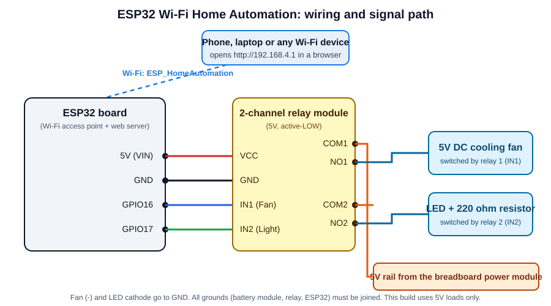
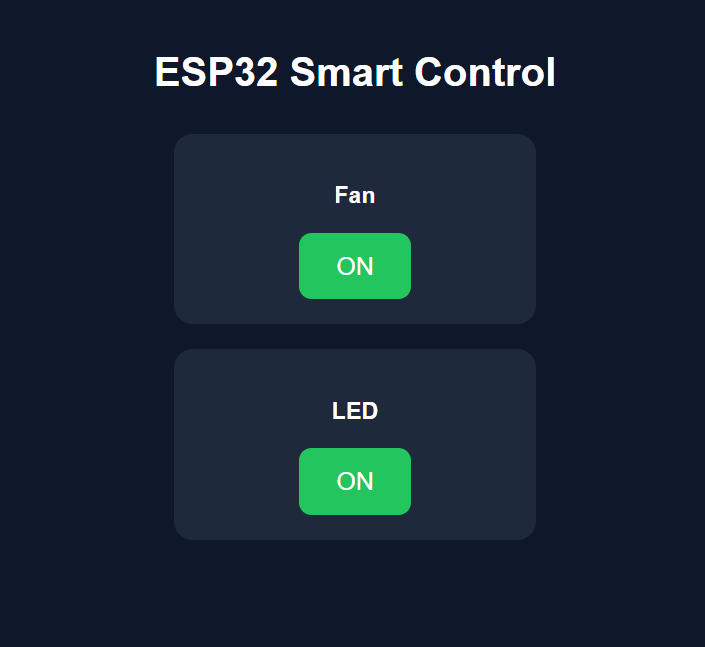
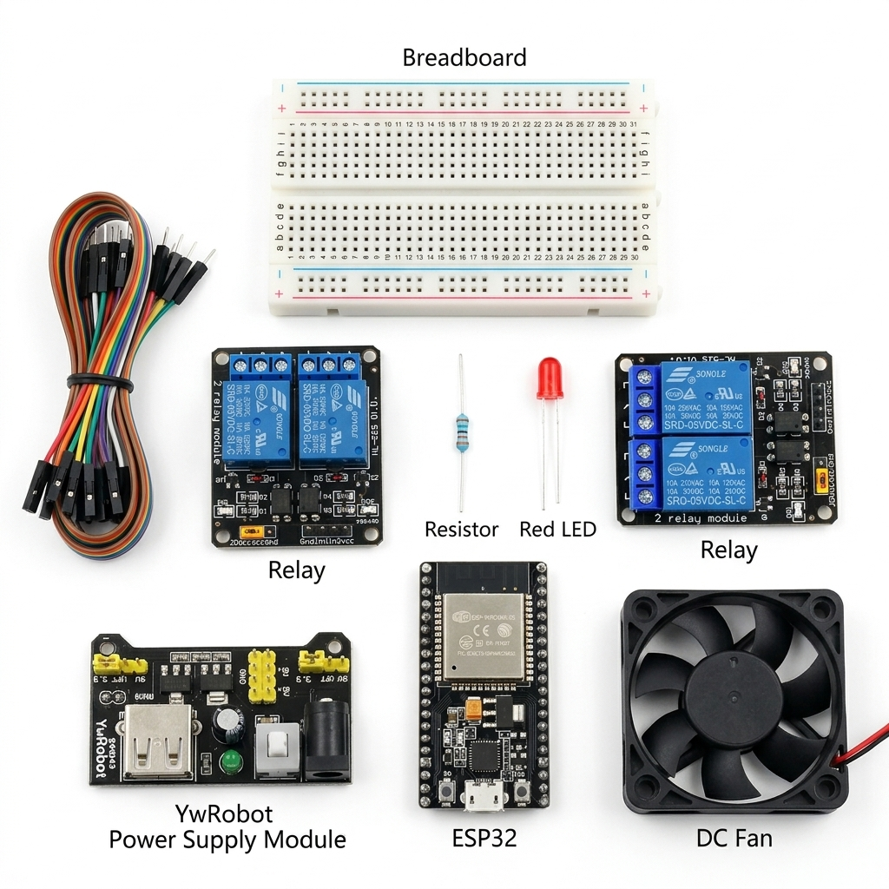

# ESP32 Wi-Fi Home Automation

Control a fan and a light from any phone or laptop over Wi-Fi. The ESP32 creates its own Wi-Fi network and serves a simple web page with ON and OFF buttons. Each button switches a relay.

**Status:** working prototype (built and tested by the author).



## What it does

- The ESP32 starts its own Wi-Fi network named `ESP_HomeAutomation` (access point mode).
- Any device with Wi-Fi and a web browser can join it and open `http://192.168.4.1`.
- The page shows two cards, Fan and LED (the light), each with an ON or OFF button.
- Pressing a button switches the matching relay, which switches the fan or the light.
- No internet connection and no mobile app are needed.

## How it works

1. The ESP32 runs a small web server on port 80.
2. Each button is a normal link: `/fan/on`, `/fan/off`, `/led/on` and `/led/off`.
3. When the ESP32 receives one of these requests it sets the relay pin LOW (relay on) or HIGH (relay off).
4. It then sends the page back with the button showing the next action.

The relay module is **active-LOW**, so `LOW` turns a relay on and `HIGH` turns it off. Both relays start in the OFF state when the board powers up.

## Hardware

| Part | Quantity | Notes |
|---|---|---|
| ESP32 development board | 1 | A common 30-pin ESP32 DevKit works |
| 2-channel 5V relay module | 1 | Must be active-LOW (most opto-isolated modules are) |
| Fan | 1 | [Write its type and voltage] |
| Light or LED | 1 | [Write its type and voltage] |
| Power supply for the loads | 1 | Matches the fan and light voltage |
| Jumper wires | several | |
| USB cable and 5V USB supply | 1 | Powers the ESP32 |

## Wiring

| ESP32 pin | Relay module pin |
|---|---|
| 5V (VIN) | VCC |
| GND | GND |
| GPIO16 | IN1 (fan) |
| GPIO17 | IN2 (light) |

Load side: connect the load power source (+) to each relay's **COM** terminal. Connect each relay's **NO** (normally open) terminal to its load. Connect the return wire of each load back to the power source (-). With NO wiring a load stays off until its relay is switched on.

**Safety first:** build and test with low-voltage loads (for example an LED with a resistor or a small DC fan) before you think about mains AC. Mains voltage can kill. Never touch the relay terminals while powered. Use an insulated enclosure. If you are not trained to work with mains wiring, do not do it.

## Repository contents

```
home-automation/
├── README.md                     Overview (this file)
├── BUILD_GUIDE.md                Step-by-step build and setup guide
├── HomeAutomation_ESP32/
│   └── HomeAutomation_ESP32.ino  The Arduino sketch
└── images/                       Photos, wiring diagram and screenshots
```

## Quick start

1. Wire the circuit as shown above.
2. Upload `HomeAutomation_ESP32/HomeAutomation_ESP32.ino` with the Arduino IDE.
3. On your phone join the Wi-Fi network `ESP_HomeAutomation`.
4. Open `http://192.168.4.1` in a browser and press the buttons.

For every detail see [BUILD_GUIDE.md](BUILD_GUIDE.md).

## Photos and demo




[Add a link to your YouTube demo video here.]

## Known limits and ideas to improve it

- **No password:** the network is open, so anyone within range can control the loads. Set a password of at least 8 characters before real use (see the build guide).
- **Short range:** you must be inside the ESP32's own Wi-Fi range.
- **State is not remembered:** after a power cut both relays return to OFF.
- **Ideas:** join your home Wi-Fi network (station mode), add more relays, add a schedule or timer, add sensors (temperature, motion), or control it from anywhere with MQTT.

## What I learned

[Write one or two sentences, for example how a relay isolates the low-voltage board from the load or how an ESP32 can act as a web server.]

## Tools

Arduino IDE, ESP32 Arduino core, `WiFi.h` library.

## Author

Mohammad Ullah, Electrical and Electronic Engineering, RUET
Portfolio: https://mohammadullah2eee.github.io
